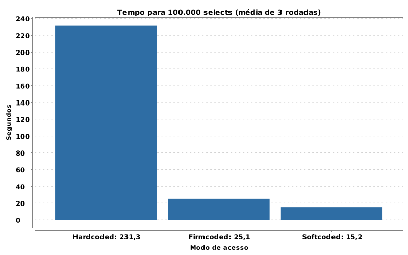
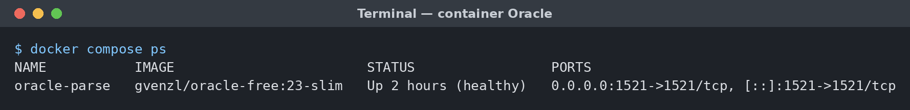
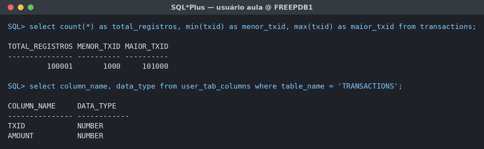
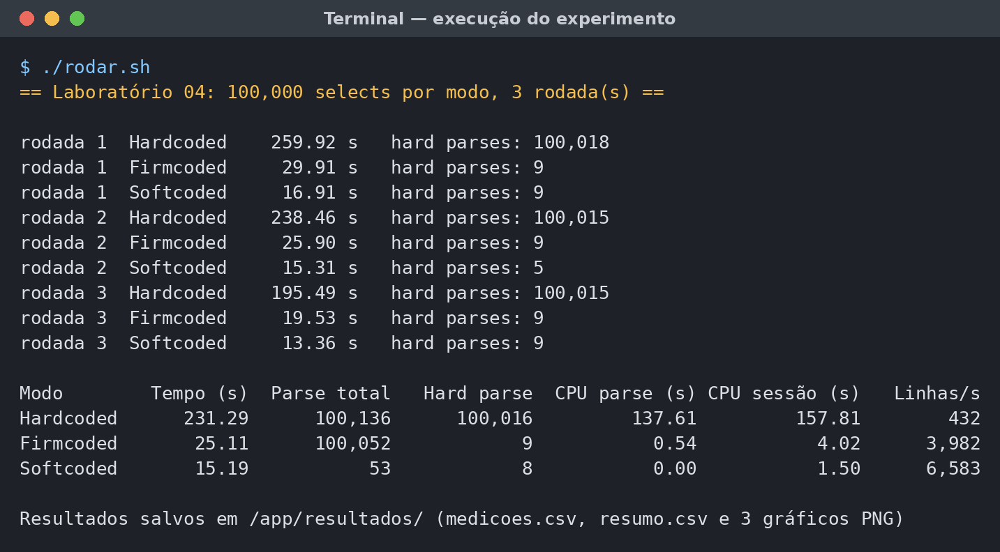
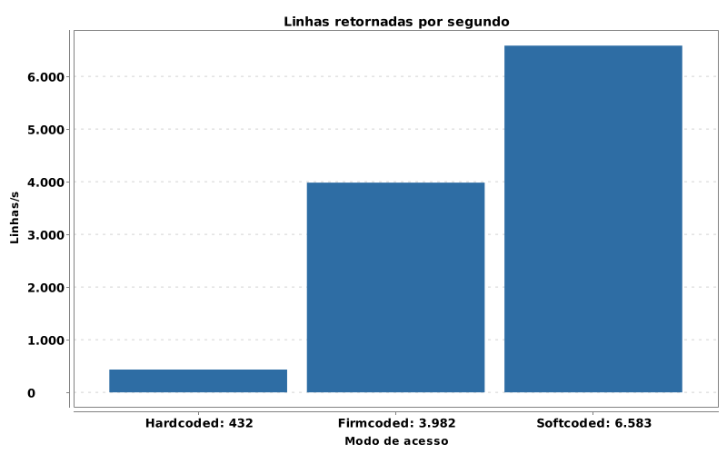
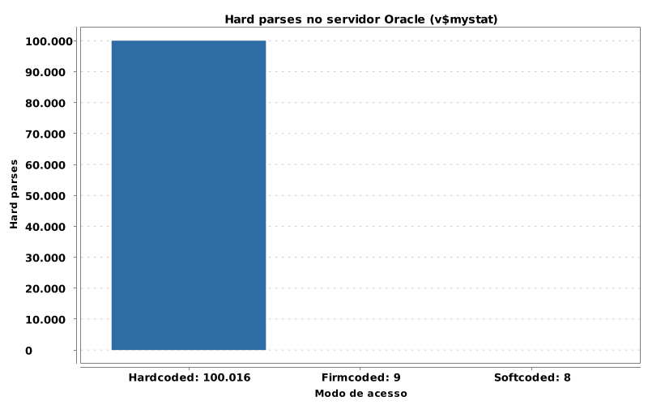
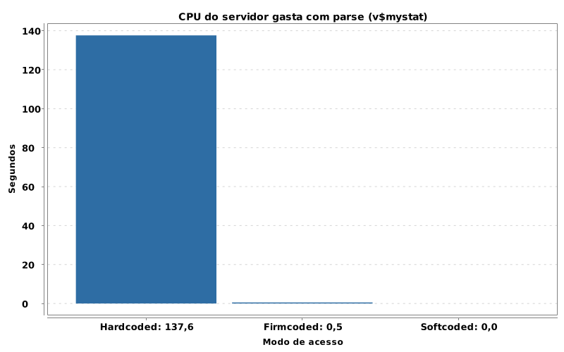
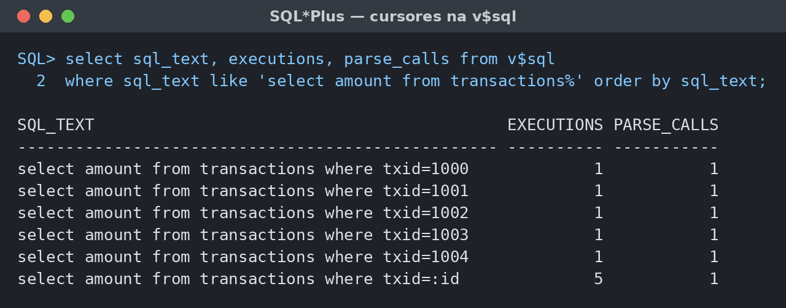

# Parse e Variáveis Embutidas: Hardcoded × Softcoded no Oracle

Laboratório 04 da disciplina **Otimização e Balanceamento de Banco de Dados**, na FATEC Jessen Vidal (São José dos Campos), com o professor Carlos Garcia.

O experimento mostra, na prática, quanto custa para o servidor o **parse** de comandos SQL. A mesma consulta foi executada 100.000 vezes de duas formas: com o valor escrito direto no texto (**hardcoded**) e com variável embutida (**softcoded**).

**Resultado:** a versão softcoded foi **15,2 vezes mais rápida**, com 15,2 s contra 231,3 s.



## Sumário

- [O exercício](#o-exercício)
- [Como rodar](#como-rodar)
- [Ambiente](#1-ambiente)
- [Criação e carga da tabela](#2-criação-e-carga-da-tabela)
- [As versões do código](#3-as-versões-do-código)
- [Como foi medido](#4-como-foi-medido)
- [Execução](#5-execução)
- [Resultados](#6-resultados)
- [Evidência no cache de comandos (V$SQL)](#7-evidência-no-cache-de-comandos-vsql)
- [Análise e conclusão](#8-análise-e-conclusão)
- [Estrutura do projeto](#estrutura-do-projeto)
- [Referências](#referências)

## O exercício

- Reproduzir em laboratório a teoria vista em aula sobre o parse de comandos e o custo gerado no servidor.
- Implementar um código que acesse o banco por um driver capaz de processar *prepared statements* (ex.: Java e JDBC).
- Elaborar duas versões do mesmo código, alternando o modo de acesso: **hardcoded** e **softcoded**.
- Executar 100.000 vezes ou mais um mesmo `SELECT` em uma tabela criada pelo aluno.
- Medir, para cada modo, o tempo gasto para processar todos os comandos.
- Montar um gráfico comparativo entre as duas versões.

Além das duas versões exigidas, foi incluída uma terceira, **firmcoded**, apresentada em aula como estágio intermediário entre as duas.

## Como rodar

Você só precisa do **Docker**. O Java e o Maven rodam dentro de um container.

```bash
# 1. Sobe o Oracle e cria a tabela com 100.001 linhas (só na primeira vez)
docker compose up -d

# 2. Aguarda o banco ficar pronto (status "healthy")
docker compose ps

# 3. Compila e roda o experimento (~15 minutos)
./rodar.sh

# Opcional: só refaz os gráficos a partir de resultados/resumo.csv
./rodar.sh --somente-graficos
```

Os parâmetros (número de execuções, rodadas, incluir ou não o firmcoded) ficam em [`application.properties`](src/main/resources/application.properties).

| Item | Valor |
|---|---|
| Host / porta | `localhost:1521` |
| Serviço | `FREEPDB1` |
| Usuário / senha | `aula` / `aula` |
| Senha do SYS/SYSTEM | `oracle` |

> As senhas são só para uso local no laboratório.

## 1. Ambiente

- **Banco:** Oracle Database 23ai Free, imagem [`gvenzl/oracle-free:23-slim`](https://hub.docker.com/r/gvenzl/oracle-free), definida no [`docker-compose.yml`](docker-compose.yml).
- **Aplicação:** Java 21, Spring Boot 3.5, JDBC puro com o driver `ojdbc11` e gráficos com XChart.
- **Máquina:** cliente e servidor no mesmo computador (6,5 GB de RAM), portanto sem latência de rede.

O container cria automaticamente o usuário `AULA` no banco `FREEPDB1` e roda o script de carga na primeira inicialização.



## 2. Criação e carga da tabela

A tabela `TRANSACTIONS` tem `TXID` como chave primária. Ela recebe 100.001 linhas, com `TXID` de 1000 a 101000, o mesmo intervalo do laço apresentado em aula. O `AMOUNT` é aleatório. Script completo: [`init/01_transactions.sql`](init/01_transactions.sql).

```sql
CREATE TABLE aula.transactions (
  txid   NUMBER PRIMARY KEY,
  amount NUMBER(12,2)
);

INSERT INTO aula.transactions (txid, amount)
SELECT 999 + LEVEL, ROUND(DBMS_RANDOM.VALUE(1, 10000), 2)
FROM dual CONNECT BY LEVEL <= 100001;

-- leitura das estatísticas (V$MYSTAT, V$SQL) e limpeza do cache entre as rodadas
GRANT SELECT_CATALOG_ROLE TO aula;
GRANT ALTER SYSTEM TO aula;
```



## 3. As versões do código

As três versões estão em [`AcessoDados.java`](src/main/java/br/fatec/lab04/AcessoDados.java).

### Hardcoded

O valor é concatenado ao texto do comando. Cada `TXID` produz um SQL diferente, então o Oracle não o encontra no cache (*shared pool*) e precisa fazer o **hard parse completo** a cada execução. Isso inclui:
- verificação sintática e semântica;
- consultas ao dicionário de dados e checagem de privilégios;
- avaliação dos índices pelo otimizador;
- montagem de um novo plano de execução.

```java
try (Statement st = con.createStatement()) {
    for (long txid = inicio; txid < inicio + total; txid++) {
        String sql = "select amount"
                   + " from transactions"
                   + " where txid=" + Long.toString(txid);
        try (ResultSet rs = st.executeQuery(sql)) {
            if (rs.next()) soma += rs.getDouble(1);
        }
    }
}
```

### Softcoded

O comando usa uma variável embutida (`?`), e o `PreparedStatement` é criado **uma única vez, fora do laço**. Dentro do laço só o valor muda. O Oracle faz o parse uma vez e reaproveita o mesmo cursor e o mesmo plano em todas as repetições.

```java
try (PreparedStatement st = con.prepareStatement("select amount"
                                               + " from transactions"
                                               + " where txid=?")) {
    for (long txid = inicio; txid < inicio + total; txid++) {
        st.setLong(1, txid);
        try (ResultSet rs = st.executeQuery()) {
            if (rs.next()) soma += rs.getDouble(1);
        }
    }
}
```

### Firmcoded (complementar)

Também usa `?`, mas recria o `PreparedStatement` a cada volta. Como o texto é sempre idêntico, o Oracle o encontra no cache e não monta um plano novo (**soft parse**). Mesmo assim, cada volta gera uma chamada de parse e a abertura e o fechamento de um cursor.

```java
for (long txid = inicio; txid < inicio + total; txid++) {
    try (PreparedStatement st = con.prepareStatement("select amount"
                                                   + " from transactions"
                                                   + " where txid=?")) {
        st.setLong(1, txid);
        try (ResultSet rs = st.executeQuery()) {
            if (rs.next()) soma += rs.getDouble(1);
        }
    }
}
```

## 4. Como foi medido

Os três modos rodam no mesmo programa ([`Experimento.java`](src/main/java/br/fatec/lab04/Experimento.java)) e na mesma conexão:

- **Tempo:** `System.nanoTime()` antes e depois de cada laço de 100.000 `SELECT`s.
- **Custo no servidor:** estatísticas da sessão em `V$MYSTAT`, lidas antes e depois de cada laço: `parse count (total)`, `parse count (hard)`, `parse time cpu` e `CPU used by this session`.
- **Mesmo ponto de partida:** `ALTER SYSTEM FLUSH SHARED_POOL` antes de cada modo, para nenhuma versão aproveitar cursores da anterior.
- **Aquecimento:** 5.000 `SELECT`s iniciais, descartados, para carregar o driver e os blocos da tabela na memória.
- **Repetição:** 3 rodadas completas. Os resultados são a média.

```sql
select n.name, s.value
  from v$mystat s join v$statname n on n.statistic# = s.statistic#
 where n.name in ('parse count (total)', 'parse count (hard)',
                  'parse time cpu', 'CPU used by this session');
```

## 5. Execução



Por rodada, o hardcoded levou entre 195,5 s e 259,9 s, e o softcoded entre 13,4 s e 16,9 s. Os tempos caem ao longo das rodadas porque o ambiente vai aquecendo; por isso o resultado usa a média das três.

## 6. Resultados

Média das 3 rodadas. Os tempos de CPU vêm do próprio Oracle (`V$MYSTAT`). Dados brutos: [`resumo.csv`](resultados/resumo.csv) e [`medicoes.csv`](resultados/medicoes.csv).

| Modo | Tempo médio (s) | Linhas/s | Parse total | Hard parses | CPU de parse (s) | CPU da sessão (s) | Ganho |
|---|--:|--:|--:|--:|--:|--:|--:|
| Hardcoded | 231,29 | 432 | 100.136 | 100.016 | 137,61 | 157,81 | 1,0× |
| Firmcoded | 25,11 | 3.982 | 100.052 | 9 | 0,54 | 4,02 | 9,2× |
| **Softcoded** | **15,19** | **6.583** | **53** | **8** | **0,00** | **1,50** | **15,2×** |

| | |
|---|---|
|  |  |
|  |  |

- O **hardcoded** fez 100.016 hard parses, praticamente um por `SELECT`. As versões com variável embutida fizeram só 9 e 8, referentes ao próprio comando e às consultas internas do programa.
- No hardcoded, o servidor gastou **137,6 s de CPU só com parse**: 87% de toda a CPU da sessão e cerca de 59% do tempo total do teste. No softcoded, esse custo foi praticamente zero.

## 7. Evidência no cache de comandos (V$SQL)

Para ver o efeito direto no *shared pool*, o cache foi limpo e foram executadas 5 consultas de cada tipo:

```sql
alter system flush shared_pool;

declare
  v number;
begin
  for i in 1000 .. 1004 loop
    -- hardcoded: valor concatenado no texto
    execute immediate 'select amount from transactions where txid=' || i into v;
    -- softcoded: variável embutida
    execute immediate 'select amount from transactions where txid=:id' into v using i;
  end loop;
end;
/

select sql_text, executions, parse_calls from v$sql
 where sql_text like 'select amount from transactions%' order by sql_text;
```



O hardcoded gerou **5 cursores diferentes**, cada um usado uma única vez. O softcoded gerou **1 cursor**, reaproveitado nas 5 execuções com uma só chamada de parse. Em 100.000 execuções, o hardcoded enche o *shared pool* com 100.000 cursores que nunca serão reutilizados.

## 8. Análise e conclusão

O experimento reproduziu a teoria da aula. A tabela, o `SELECT` e o número de execuções eram os mesmos; a única diferença foi a forma de escrever o comando. Mesmo assim, o softcoded foi **15,2× mais rápido**.

- **A causa está no servidor.** No hardcoded, cada `SELECT` exigiu um hard parse completo, que somou 137,6 s de CPU.
- **O firmcoded eliminou os hard parses**, mas manteve 100.052 chamadas de parse (soft parse). Isso explica os 9,9 s a mais em relação ao softcoded, que fez apenas 53 chamadas de parse no total.
- **O Oracle guarda o plano de execução** no *shared pool*. Quando só os parâmetros mudam, a variável embutida permite reaproveitar o plano. A principal mudança entre hardcoded e firmcoded foi justamente eliminar o parse completo.
- **A diferença foi maior que a do livro de referência** (Faroult, 2008), em que o softcoded no Oracle é cerca de 6,5× mais rápido. Contribuem para isso o ambiente com pouca memória para o Oracle e a limpeza do cache antes de cada modo.

**Limitações**
- Tudo rodou em uma única sessão, sem concorrência. Com várias sessões simultâneas, o hard parse também disputa os *latches* do *shared pool*, o que tende a aumentar a diferença.
- Cliente e servidor estavam na mesma máquina, sem latência de rede real.

**Conclusão:** comandos executados repetidamente devem usar variáveis embutidas e ser preparados uma única vez. Além do ganho de desempenho, isso:
- reduz o uso de memória do *shared pool*;
- protege contra **SQL injection**, já que os valores não fazem parte do texto do comando.

## Estrutura do projeto

```
├── docker-compose.yml          # Oracle 23ai Free
├── init/01_transactions.sql    # criação e carga da tabela + permissões
├── rodar.sh                    # compila e roda via container Maven + JDK 21
├── pom.xml
├── src/main/java/br/fatec/lab04/
│   ├── AcessoDados.java        # as versões hardcoded, firmcoded e softcoded
│   ├── Experimento.java        # mede tempo e estatísticas, gera CSV e gráficos
│   ├── EstatisticasOracle.java # leitura da V$MYSTAT e flush do shared pool
│   └── Grafico.java            # gráficos de barras (XChart)
├── resultados/                 # CSVs e gráficos gerados
└── docs/img/                   # evidências usadas neste README
```

## Referências

- FAROULT, Stéphane; L'HERMITE, Pascal. *Refactoring SQL Applications*. Sebastopol: O'Reilly Media, 2008.
- GARCIA, Carlos. *Parse e variáveis embutidas*. Material de aula, Otimização e Balanceamento de Banco de Dados, FATEC São José dos Campos.
